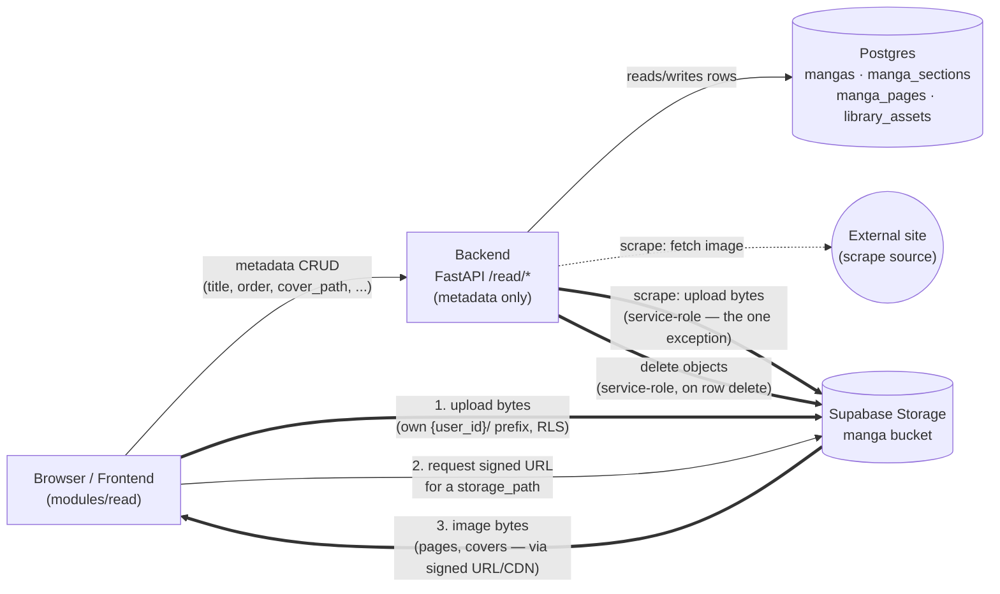

# Module: `read`

> Per-module architecture doc for the manga-reader backend (code-level module name:
> **`read`**; **"Lector"** is the frontend display label only). Mirrors the chat
> module's doc. Read `../backend_guidelines.md` first — in particular its `shared/`
> section, which now includes the Storage client this module depends on.

## Status

**Proposal.** Agreed design, not yet built. Pairs with `supabase/docs/modules/read.md`
(tables + bucket) and `frontend/docs/modules/read.md` (UI + direct-to-storage).

## Responsibility

The `read` module owns one business capability: **managing a user's manga library —
series, their volumes/chapters, and the ordered page images** — including importing
pages by scraping an external site, and a per-user **staging pool** of scraped/uploaded
images that haven't been organized into a series yet.

The pool lives here (not a separate `utils`/`temp` module) because it has no seam to
cut along: its producer is this module's `scraper.py` (and direct uploads this module
already handles), its store is this module's `manga` bucket, and its *only* consumer is
this module's organize step (pool asset → `manga_page`). A module whose producer,
storage, and sole consumer are all `read` is one feature, not two.

It does **not** own:
- Storing the image **bytes** → that's Supabase **Storage** (the `manga` bucket). This
  module stores only **metadata rows** (paths, order) and, for scrape-import, relays
  bytes into Storage via the `shared/storage/` client. Local-upload bytes never touch
  the backend — the frontend uploads them straight to Storage (see *Upload flows*).
- Authentication / "who is the user" → `modules/auth`'s public surface
  (`get_current_user`).
- Configuration → `core/config.py`.

---

## Structure

```
backend/app/modules/read/
├── __init__.py
├── router.py            # HTTP endpoints: /read/mangas*, /read/sections*, /read/pages*, /read/library*, /scrape*, /import
├── repository.py        # ReadRepository — all DB access (mangas/sections/pages/library), user-scoped
├── models.py            # Manga, MangaSection, MangaPage, LibraryAsset ORM (Supabase-migrated tables)
├── scraper.py           # Extracted component — fetch a page URL, extract image candidates
├── extractors/          # Per-site extractors for readers the generic scraper can't read
│   ├── __init__.py      #   for_url(url) — which site (if any) owns a URL
│   ├── base.py          #   ExtractorError (user-facing message), SeriesEntry
│   ├── browser.py       #   Playwright helper — open a page headlessly, capture one JSON response
│   └── mangafire.py     #   mangafire.to — volume/chapter pages + a series' volume list
├── translate/           # Extracted component — translate-by-reference image pipeline (OpenCV, no I/O)
│   ├── __init__.py      #   translate_by_reference(target, reference), TranslateRefusal, align
│   ├── align.py         #   SIFT + RANSAC similarity fit of the reference onto the target; refuses poor fits
│   ├── regions.py       #   tone match + changed-region grouping; GlyphHeuristic decides which groups are text
│   ├── compose.py       #   feathered composite of the reference's lettering over the target
│   └── errors.py        #   TranslateRefusal (user-facing message)
├── dependencies.py      # DI: get_read_service / get_scrape_service / get_version_service
├── schemas/             # API-boundary shapes, grouped by purpose (package)
│   ├── __init__.py      #   public surface — re-exports; lists request vs response
│   ├── manga.py         #   MangaCreate/Update (req) · MangaSummary/Detail (resp)
│   ├── section.py       #   SectionCreate (req) · SectionSummary (resp)
│   ├── page.py          #   PageRecord/ReorderRequest (req) · PageInfo (resp)
│   ├── library.py       #   LibraryAssetRecord/OrganizeRequest (req) · LibraryAssetInfo (resp)
│   ├── scrape.py        #   ScrapeRequest/SeriesRequest/ImportRequest (req) · ScrapeResult/SeriesResult (resp)
│   └── version.py       #   TranslateRequest/AcceptVersionRequest (req) · VersionPreview (resp)
└── services/            # Service layer — one scope per file
    ├── __init__.py
    ├── read.py          #   ReadService — CRUD over mangas/sections/pages + reorder + pool organize/discard + file cleanup
    ├── scrape.py        #   ScrapeService — fetch+extract, then import (download → Storage) to a section or the pool
    └── versions.py      #   PageVersionService — upscale/translate previews, accept, discard, remove
```

`models.py` is an ORM **mirror** of the migration-defined tables (FK into `auth.users`
+ RLS ⇒ owned by Supabase migrations, not `create_all`) — same rule as chat.

---

## File-by-File

### `router.py` — HTTP boundary (thin)
`APIRouter(tags=["read"])`. Every handler resolves its service via `Depends` and
delegates — no branching here.

| Method & path | Service call |
|---|---|
| `GET /read/mangas` | `ReadService.list_mangas()` |
| `POST /read/mangas` | `ReadService.create_manga(body)` |
| `GET /read/mangas/{id}` | `ReadService.get_manga(id)` → 404 if not owned (includes its sections) |
| `PATCH /read/mangas/{id}` | `ReadService.update_manga(id, body)` |
| `DELETE /read/mangas/{id}` | `ReadService.delete_manga(id)` (also deletes its Storage files) |
| `POST /read/mangas/{id}/sections` | `ReadService.create_section(id, body)` |
| `DELETE /read/sections/{id}` | `ReadService.delete_section(id)` (+ Storage files) |
| `GET /read/sections/{id}/pages` | `ReadService.list_pages(id)` → ordered `PageInfo[]` |
| `POST /read/sections/{id}/pages` | `ReadService.record_pages(id, body)` — persist rows for already-uploaded files |
| `PATCH /read/sections/{id}/pages/order` | `ReadService.reorder_pages(id, body)` |
| `DELETE /read/pages/{id}` | `ReadService.delete_page(id)` — row + Storage file; later pages move up one (`ReadRepository.delete_page`) |
| `POST /read/scrape` | `ScrapeService.scrape(url)` → candidate image URLs (+ the `referer` downloads need); a direct image link comes back as a single candidate. 422 on `ExtractorError` — including a site refusing the fetch (e.g. 403 from bot protection), with a hint to paste the image address instead |
| `POST /read/scrape/series` | `ScrapeService.list_series(url, language)` → a series' volumes in reading order; 422 on `ExtractorError` |
| `POST /read/sections/{id}/import` | `ScrapeService.import_into(id, body, at)` — the **direct pull**: download + upload + record straight into a section, in request order. `?at=N` inserts from position N instead of appending |
| `GET /read/library` | `ReadService.list_library()` → the user's pool, in collect order |
| `POST /read/library` | `ReadService.stream_record_library_assets(body)` — NDJSON stream, one line per pool file the frontend already uploaded |
| `POST /read/library/import` | `ScrapeService.stream_import_to_library(body)` — NDJSON stream, one line per scrape candidate downloaded into the pool |
| `POST /read/sections/{id}/pages/from-library` | `ReadService.organize_from_library(id, body, at)` — move ordered pool assets into a section; `?at=N` inserts from position N (the reader's "add page before/after") |
| `DELETE /read/library/{id}` | `ReadService.discard_library_asset(id)` (also deletes the Storage file) |
| `POST /read/pages/{id}/upscale` | `PageVersionService.upscale_preview(id)` → `VersionPreview` `{kind, language, preview_path, preview_url, width, height, reference_page_id}` (×2 of the original) |
| `POST /read/pages/{id}/translate` | `PageVersionService.translate_preview(id, body.reference_page_id)` → `VersionPreview`. 422 if the reference is the page itself or the pipeline refuses (`TranslateRefusal`); 404 if the reference isn't in the same section |
| `POST /read/pages/{id}/versions/accept` | `PageVersionService.accept(id, kind, language, reference_page_id)` → `PageVersionInfo`; 404 when there's no preview to accept |
| `DELETE /read/pages/{id}/versions/preview?kind=…` | `PageVersionService.discard(id, kind)` — 204 even if the preview is already gone |
| `DELETE /read/pages/{id}/versions?kind=…&language=…` | `PageVersionService.remove(id, kind, language)` — row + file; 404 if there's no such version |

The version routes share one error mapping (`_version_errors` in `router.py`):
`VersionError` → its own status + message, `TranslateRefusal` → 422, `UpscaleRejected`
(the models service refused the image) → 422 with its detail, `UpscaleUnavailable` →
503 *"The upscaler isn't running. Start the models service and try again."* Every
version route returns 404 for a page the caller doesn't own.

Inserting in the middle and deleting both keep positions contiguous from 0:
`ReadRepository.reserve_positions(section, count, at)` shifts the pages from `at`
down by `count` before the insert, and `delete_page` shifts the later ones up by
one. Both go through negative positions first (`_shift_positions`), like
`set_positions`, because the unique `(section_id, position)` index is checked row
by row.

### `services/read.py` — `ReadService` (request-scoped)
CRUD + reorder over the four tables, scoped to `user.id` on every query (the
defense-in-depth note in the schema doc applies — ownership is enforced **here**, not
by table RLS). On manga/section/page deletes it also removes the corresponding objects
from the `manga` bucket via the `shared/storage/` client (the DB cascade drops rows
only, not files). `record_pages` writes the `manga_pages` rows for files the **frontend
already uploaded** to Storage — the request carries `[{storage_path, position, width,
height}]`; the service validates the paths sit under this user's prefix before
inserting.

It also owns the **pool** side (`library_assets`):
- `list_library()` — the user's unassigned pool, in collect order (a collection queue —
  freshly collected images appear at the bottom). Ordered by `position`, not
  `created_at`, and excludes any row still mid-collect (`storage_path IS NULL` —
  see `services/library_stream.py` below): a batch's images can finish
  downloading/uploading out of order, so `position` is fixed from the batch's
  original order at *reservation* time, before any of the slow work starts —
  immune to which item actually finishes first.
- `stream_record_library_assets(records)` — the pool twin of `record_pages`, but
  streamed: see `services/library_stream.py`.
- `organize_from_library(section_id, ordered_asset_ids)` — the pool → section move. For
  each chosen asset (in the given order) it inserts a `manga_pages` row pointing at the
  asset's existing `storage_path` and deletes the `library_assets` row, in **one
  transaction**. The Storage object is **not** touched — ownership transfers from the
  pool row to the page row (the path stays valid; see the schema doc's bucket note).
- `discard_library_asset(id)` — drop an unused pool asset: delete the row **and** its
  Storage object (unlike organize, this one *does* remove the file).

### `services/scrape.py` — `ScrapeService` (request-scoped)
Deliberately split across requests so the user picks in between:
1. `scrape(url)` — ask `extractors.for_url(url)` first; a per-site extractor wins,
   otherwise delegate to the generic `scraper.py`. Returns candidate image URLs (with
   dimensions where known) plus the extractor's required `referer`. No persistence.
   `list_series(url, language)` is the series-level twin: a supported site's volume
   list, each entry's `url` feeding back into `scrape`.
2. `import_into(section_id, ordered_urls, referer, sizes)` — the **direct pull**: for
   each chosen URL, download the image **server-side** (browsers can't fetch
   cross-origin/hotlink-protected images), upload it to the `manga` bucket under the
   user's section prefix via `shared/storage/` (service-role), then record the
   `manga_pages` rows. Positions come from the request order and are fixed before the
   (concurrent, bounded) downloads and uploads start, so pages land in exactly the
   order sent — for an extractor, the site's own page order. `sizes` (keyed by URL)
   fills `width`/`height` when the source knows them. Still a single batched response.
3. `stream_import_to_library(urls)` — the **pool** path (the decoupled flow), now
   streamed: see `services/library_stream.py`.

### `services/library_stream.py` — shared streaming-collect orchestration
Reused by both `stream_record_library_assets` and `stream_import_to_library` — the
two ways images land in the pool. `stream_collect(repo, user_id, items, concurrency,
source_url, prepare)`:
1. Reserves one placeholder row per item upfront, via
   `ReadRepository.reserve_library_asset_slots` — real `library_assets` rows, with
   `position` (and `source_url`, when already known) fixed immediately, but
   `storage_path` left `NULL` until that item's work finishes. This is what lets
   `position` reflect the batch's *original* order regardless of which item's
   download/upload actually completes first, without needing a separate counter
   table — see `reserve_library_asset_slots`'s docstring for the concurrency-safety
   argument.
2. Runs `prepare(item)` concurrently (bounded by `concurrency`) — the flow-specific
   work (download+upload for scrape, prefix validation for upload-record).
3. The moment each item's `prepare` resolves, fills in its reserved row
   (`fill_library_asset`) and yields one `LibraryStreamItem` NDJSON line — in
   whatever order items actually finish, not request order (the frontend keys off
   `index`, not line order). A failed item's reserved row is deleted rather than
   left half-filled, and its own `LibraryStreamItem` reports `ok: false`.

The request-scoped `AsyncSession` is one connection — concurrent tasks can't
`flush()`/`commit()` on it simultaneously, so the per-item DB write (not the slow
`prepare()` work) is serialized through an `asyncio.Lock`.

### `services/versions.py` — `PageVersionService` (request-scoped)
Upscaled and translated **versions** of a page (`manga_page_versions`: at most one
upscale, and one translation per language). Every run produces a **preview** first,
at `{user}/_preview/{page_id}-{kind}.png`, overwritten by the next run (Storage won't
overwrite, so the old object is removed, then the new one uploaded). Each preview
response includes a freshly signed `preview_url`, since a URL signed earlier for the
same path would serve the old, year-cached bytes.
- `upscale_preview(page)` — download the **original** (never an earlier upscale), send
  it to the models service through `shared/images/` (`UpscaleClient`), upload the PNG.
- `translate_preview(page, reference)` — both pages must be the caller's and in the
  same section. Starts from the accepted upscale if there is one, else the original,
  and upscales it first only when it's shorter than the reference. Then runs
  `translate/` in the threadpool. Language is fixed to `"en"` for now.
- `accept(page, kind, language, reference)` — download the preview (404 if none) to
  read its size, `move` it to `{user}/{manga}/{section}/v-{uuid}.png`, upsert the
  version row, commit, then remove the file it replaced. An upscale carries no
  language or reference; a translation defaults to `"en"`.
- `discard(page, kind)` removes the preview object; `remove(page, kind, language)`
  deletes the row, commits, then removes the file.

Images are decoded as 3-channel BGR (`cv2.IMREAD_COLOR`), since grey and colour pages
can't be mixed in the pipeline; an undecodable one is a 422. Decode, encode and the
pipeline run via `run_in_threadpool`. Original and reference files are only read.
Stale previews that are never accepted or discarded are left in place for now.

### `translate/` — extracted component
The translate-by-reference image pipeline: plain OpenCV on in-memory arrays, no
Storage or DB. `translate_by_reference(target_bgr, reference_bgr)` returns an image
the size of the target. `align.py` fits a similarity transform (SIFT, ratio test,
RANSAC) and refuses poor fits; `regions.py` tone-matches the warped reference and
groups the pixels that differ in both brightness and sharp ink (a black-hat), so
steam an edition paints over the art and tiny line-art differences between scans
never join or pass as lettering. It keeps only groups the `TextClassifier` (today
`GlyphHeuristic`, a seam for a trained detector later) calls lettering: enough
letter-sized marks (not halftone dots) on bubble paper. Text printed straight on the
art, outside a bubble, is left alone by design. `compose.py`
feathers those groups onto the target. Sizes are tuned at 1024 px and scale with
page height. A refusal (`TranslateRefusal`) carries a user-facing message: poor
alignment, or *"Nothing to translate"* when no text groups are found.

### `scraper.py` — extracted component
Owns the fetch + HTML-parsing complexity (its own testable invariants ⇒ Component
Extraction). Uses `httpx` + a fast parser (`selectolax`). Handles lazy-loaded images
(`data-src`, `srcset`, `<picture><source>`), image lists embedded as JSON in
`<script>` or in an HTML **attribute** (Inertia.js `data-page`, etc. — a raw-HTML
fallback used only when the structured passes find nothing), and **HTMX-rendered
readers** — pages whose images load from a separate
`hx-get` fragment fired on `load` (e.g. WeebCentral): `scrape()` follows those
fragments in the same session, sending the `HX-Request` header and the `hx-include`
params (with defaults for client-only state like `reading_style`) the endpoint
requires. Sends a browser `User-Agent` so Cloudflare/CDNs don't reject it. Ships a
generic extractor; per-site extractors can be added behind the same interface later.

### `extractors/` — per-site extractors
For readers the generic scraper can't read. Each site module exposes `matches(url)`,
`scrape(url)`, `list_series(url, language)` and a `REFERER` constant; `for_url()`
picks the owner of a URL. A failure raises `ExtractorError`, whose message the
router returns as a 422 `detail` for the UI to show.

- `browser.py` — some readers are fully client-rendered: the HTML is an empty shell
  and the page list comes from the site's own API, signed with a token its
  JavaScript builds. Rather than reimplement that, `capture_json(url, pattern)` opens
  the page in headless Chromium (Playwright) like a normal visitor and returns the
  JSON body of the first response matching `pattern`. It runs in its own thread +
  event loop (Proactor on Windows, which Playwright's subprocess needs), launches a
  fresh browser per call, and imports Playwright lazily, so the backend still starts
  without it (the extractor then fails with an install hint).
- `mangafire.py` — `/title/{slug}/volume/{id}` and `/title/{slug}/chapter/{id}`
  pages: captures `/api/volumes/{id}` / `/api/chapters/{id}` (ordered pages with
  sizes). `/title/{slug}`: captures `/api/titles/{hid}/volumes` (every volume, all
  languages; filtered to `language`). Chapters aren't listed at series level: the
  site pages them 20 at a time, so chapters are pulled one link at a time. Its CDN
  requires `Referer: https://mangafire.to/`.

Playwright is a backend dependency (`requirements.txt`) plus a one-time
`python -m playwright install chromium` (the Dockerfile does this with
`--with-deps`; `run_backend.bat` runs it on every launch, a no-op once installed).

> **Responsible-use note.** Scraping re-hosts third-party images; only content the user
> is authorized to copy should be imported. Respecting each site's ToS/robots is the
> user's responsibility — the component stays generic and adds no evasion.

### `repository.py` — `ReadRepository`
All DB access for the four tables, every method filtering/joining on ownership:
`list_mangas(user_id)`, `get_manga(id, user_id)`, `create_manga`, `update_manga`,
`delete_manga`, `create_section`, `delete_section`, `list_pages(section_id)`,
`insert_pages(rows)`, `set_positions(...)`, plus the pool:
`list_library(user_id)`, `next_library_position(user_id)` (one past the highest
position — not a count, since taking assets out of the pool leaves gaps; includes
reserved-but-unfilled slots — deliberately no `storage_path` filter, unlike `list_library`),
`reserve_library_asset_slots(user_id, source_urls)` (the upfront reservation step —
see `services/library_stream.py`), `fill_library_asset(asset_id, fields)` (completes
a reserved slot), `get_library_assets(ids, user_id)`, `delete_library_assets(ids,
user_id)`.
`organize_from_library` composes `get_library_assets` + `insert_pages` +
`delete_library_assets` in one transaction. Returns `None`/empty when not owned so
the router maps to 404.

### `models.py` — ORM mirror
`Manga`, `MangaSection`, `MangaPage`, `LibraryAsset` — typed views of the
migration-defined tables, nothing more (the tables, FKs, RLS, and bucket live in
`supabase/migrations/`).

### `schemas/` — API boundary (package, grouped by purpose)
Import from `modules.read.schemas`. Requests carry only what the client sends (e.g.
`PageRecord` = `storage_path` + `position` + dims; `LibraryAssetRecord` =
`storage_path` + optional `source_url` + dims; `OrganizeRequest` = ordered
`asset_ids`); responses are the stored shapes (`PageInfo`/`LibraryAssetInfo` add the
id; the reader/pool grid resolve bytes via signed URLs themselves — see below).

### `dependencies.py` — DI surface
`get_read_service` / `get_scrape_service` / `get_version_service` build their
request-scoped service from a fresh `AsyncSession`, the current user (`modules.auth`),
and the singleton Storage client off `app.state`. `get_version_service` also passes
the singleton `UpscaleClient` (`app.state.upscale_client`, from `shared/images/`).

---

## Storage — bytes vs metadata

This module is the **metadata** authority; **Supabase Storage** holds the bytes.



Thick (`==>`) edges are the ones that actually move image bytes — notice almost all of
them are Browser ↔ Storage direct, with the backend only stepping into that path for
scrape-import, upscale/translate, and cleanup-on-delete (all service-role, all called
out in the bullets below). The thin edges are metadata-only: step 2 is just "give me a signed URL for this
path" (a request, no bytes), and the constant thing the backend actually does is the
`Browser → Backend → Postgres` metadata line at the top.

- **Local upload:** frontend uploads files **directly to Storage** (RLS-gated by owner
  path), then calls `POST /read/sections/{id}/pages` (into a section) or `POST
  /read/library` (into the pool) so this module records the rows. No image bytes pass
  through the backend.
- **Scrape import:** the backend downloads + uploads server-side (one of the two paths
  where bytes flow through the backend; upscale/translate below is the other), using the **service-role key** via `shared/storage/`
  — either straight into a section (`/read/sections/{id}/import`) or into the pool
  (`/read/library/import`).
- **Upscale / translate:** the backend downloads the page (and reference) images,
  runs them through the models service's upscaler (`shared/images/`) and/or
  `translate/`, and writes the result back (service-role): a preview under
  `{user}/_preview/`, moved to `{user}/{manga}/{section}/v-{uuid}.png` on accept.
  The preview path is reused by every run and objects are cached for a year, so the
  preview response carries a freshly signed `preview_url` with a random `v` parameter
  (Storage's own token only changes once a second), so every preview is a new cache key.
  The UI shows that URL rather than signing `preview_path` itself.
  `StorageClient.download` raises `StorageObjectNotFound` for a missing object, which
  is how accept tells "no preview" apart from a Storage failure.
- **Organize (pool → section):** metadata-only. The page row reuses the pool object's
  existing `_pool/` path, so **no bytes move** — the backend just swaps a
  `library_assets` row for a `manga_pages` row in one transaction.
- **Reading / browsing the pool:** the frontend mints batch **signed URLs** for a
  section's pages (or the pool's assets) directly from Storage (RLS-gated) and loads
  them from the CDN — the backend serves only the ordered/listed metadata (`GET
  /read/sections/{id}/pages`, `GET /read/library`), not the images.

New `core/config.py` keys (server-only): `SUPABASE_SERVICE_ROLE_KEY` (**secret — never
exposed to the frontend**) and `MANGA_BUCKET` (default `"manga"`). New deps:
`selectolax` (HTML parsing), `httpx` (fetch/download) and `playwright` (headless
Chromium for `extractors/`) — see `shared/storage/` in the backend guidelines for the
Storage client itself.

---

## Dependency flow (downward only)

```
modules/read/router.py
    ├─→ modules/auth/dependencies.py (get_current_user)            # public surface
    ├─→ modules/read/services/read.py (ReadService)
    │       ├─→ modules/read/repository.py (ReadRepository) ─→ core/database (AsyncSession)
    │       │       # mangas/sections/pages + library_assets (pool); organize = one txn
    │       └─→ shared/storage/ (delete objects on page/manga/section delete or pool discard)
    ├─→ modules/read/services/scrape.py (ScrapeService)
    │       ├─→ modules/read/extractors/ (per-site; Playwright → image candidates / series list)
    │       ├─→ modules/read/scraper.py (httpx + selectolax → image candidates)
    │       ├─→ modules/read/repository.py (record imported pages OR pool assets)
    │       └─→ shared/storage/ (upload downloaded images, service-role)
    └─→ modules/read/services/versions.py (PageVersionService)
            ├─→ modules/read/translate/ (OpenCV: align → text regions → composite)
            ├─→ modules/read/repository.py (pages + manga_page_versions)
            ├─→ shared/images/ (UpscaleClient → models service /v1/images/upscale)
            └─→ shared/storage/ (download/upload/move/remove, service-role)
```

`read` imports from `shared/`, `core/`, and `modules/auth`'s public surface only.

---

## Future

- Thumbnail generation (Supabase image transforms) for grid/cover views.
- Reading-progress persistence (`last_position` per section) once the reader lands.
- Pagination on the library + page lists once volumes grow.
- More per-site extractors; a series-level chapter list (needs paging through the site's UI).
